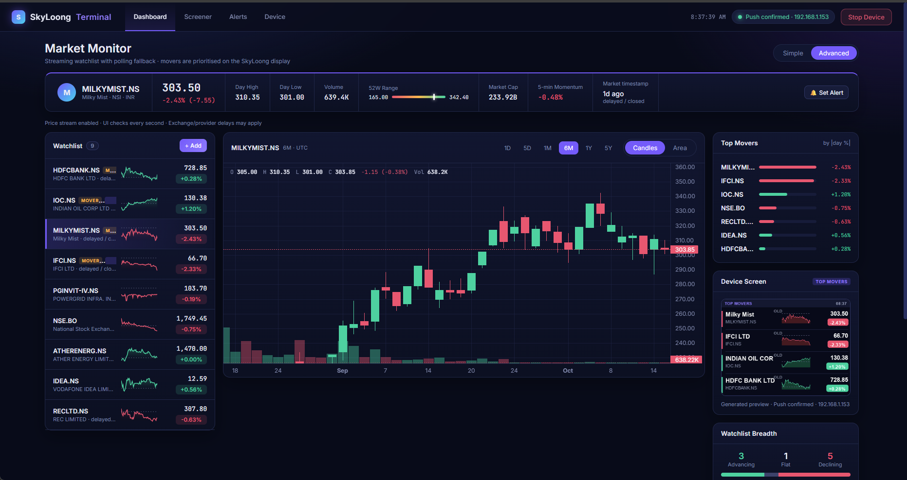
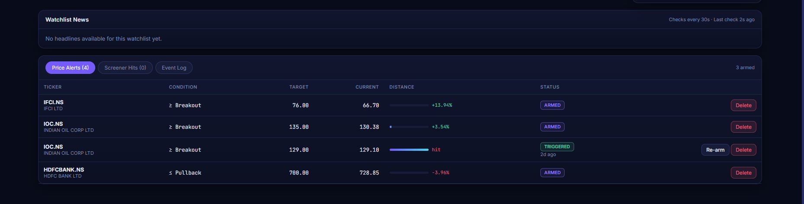
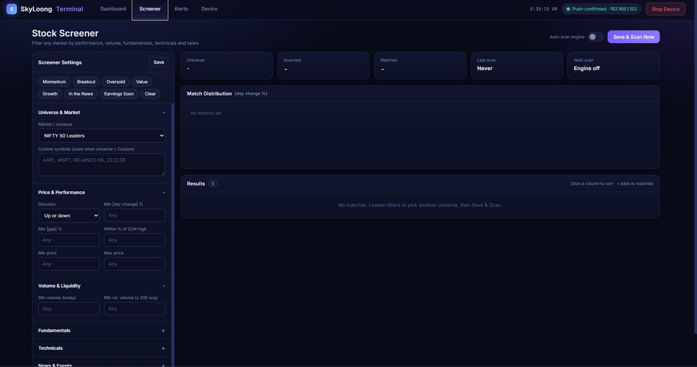
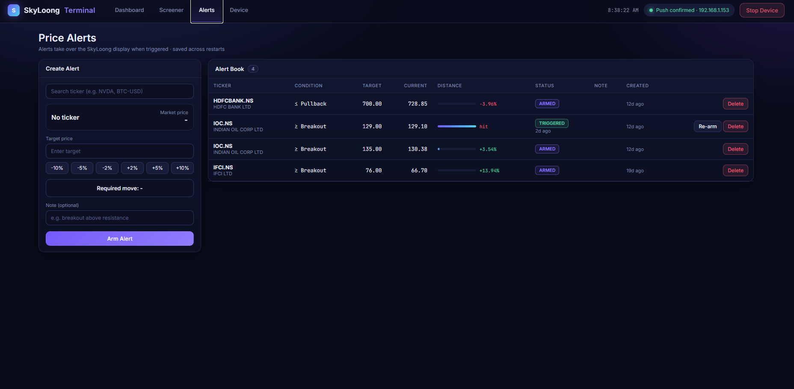
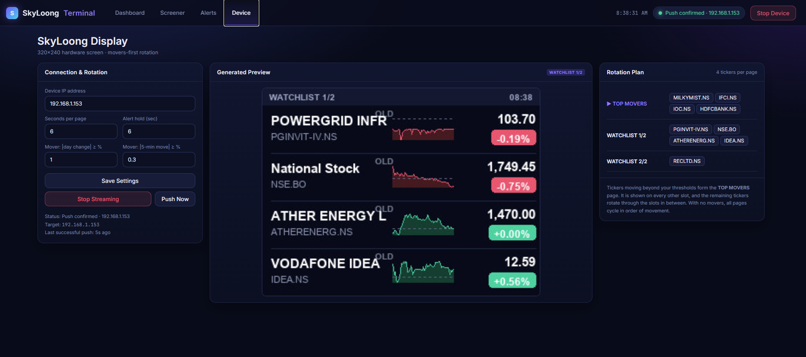
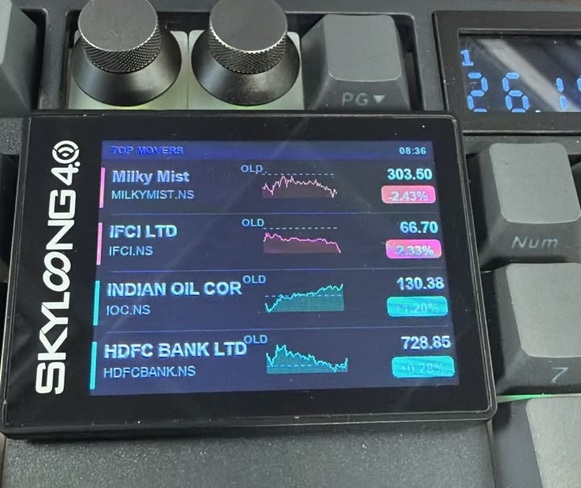

# Lyman-Alpha_Trading_Terminal

A local Python market terminal with live/polled quotes, technical & fundamental screening, watchlists, news, price alerts, interactive charts, and a 320×240 SkyLoong hardware display.

## Screenshots

### Dashboard — Market Monitor

Streaming watchlist with interactive candlestick charts, top movers, a device-screen preview, and watchlist breadth.

### Watchlist News & Price Alerts

Live news feed alongside an at-a-glance table of armed and triggered price alerts with distance-to-target.

### Stock Screener

Filter any market by performance, volume, fundamentals, technicals, and news, with a saveable auto-scan engine.

### Price Alerts

Create and manage breakout / pullback alerts that take over the SkyLoong display when triggered and persist across restarts.

### SkyLoong Display — Generated Preview

Movers-first rotation rendered for the 320×240 hardware screen, with a configurable rotation plan.

### SkyLoong 4.0 Hardware

The live top-movers page pushed to the physical SkyLoong keyboard display.

